# 🎨 FinanceOS Mermaid Diagrams

This document contains full Mermaid diagram definitions for system architecture, authentication flows, role-based workflows, rule engine evaluations, multi-agent orchestration, RAG query processing, and sequence diagrams.

---

## 🏗️ 1. Complete System Architecture

The diagram below illustrates the complete flow of authentication, role verification, rule evaluation, multi-agent orchestration, document retrieval, response generation, analytics collection, and persistent storage.

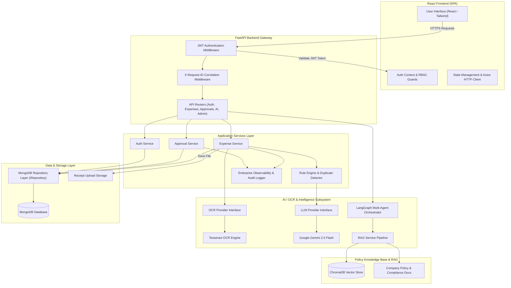

---

## 🔐 2. Authentication & Authorization Flow

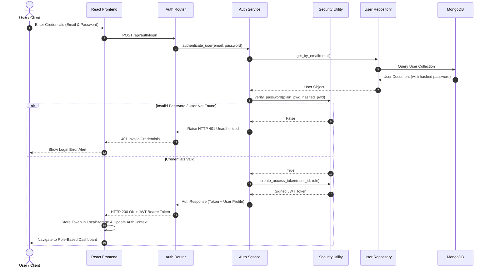

---

## 👤 3. Role-Based Workflows

### 👨‍💻 3.1 Employee Workflow

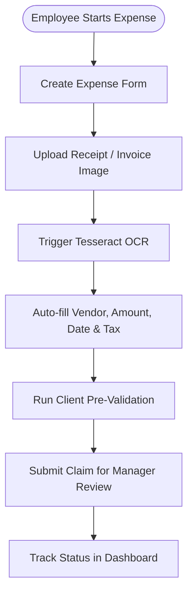

### 👨‍💼 3.2 Manager Workflow

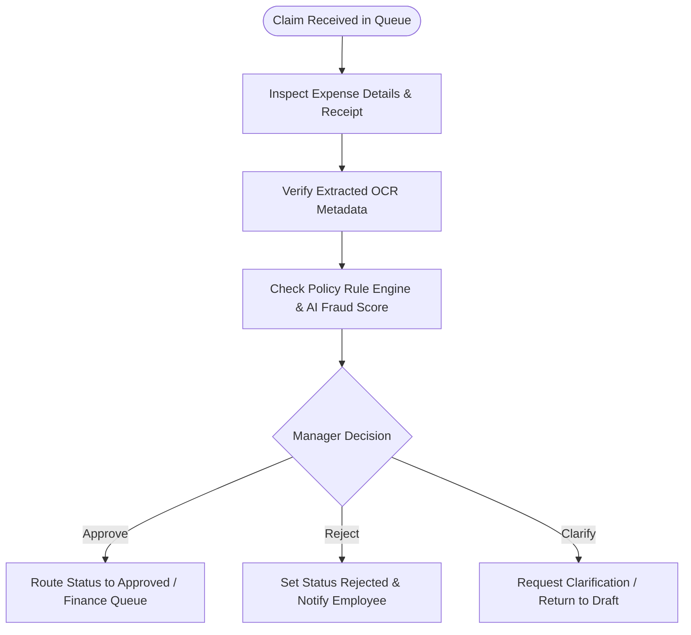

### 💼 3.3 Financial Officer Workflow

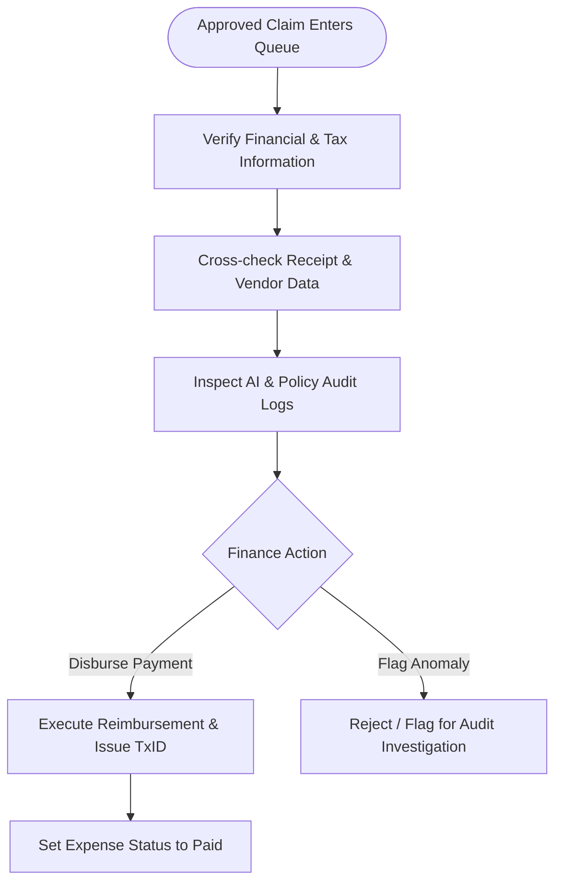

### 🛠️ 3.4 Admin Workflow

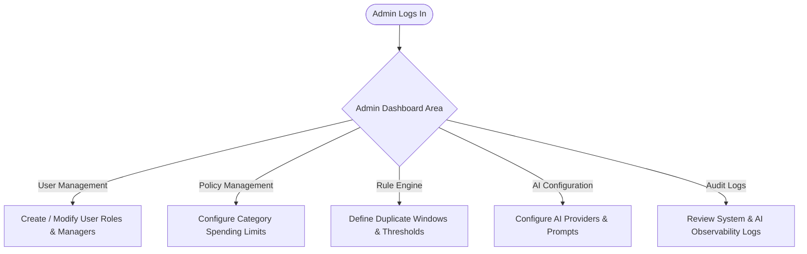

---

## 🔄 4. Complete Expense Lifecycle Sequence Diagram

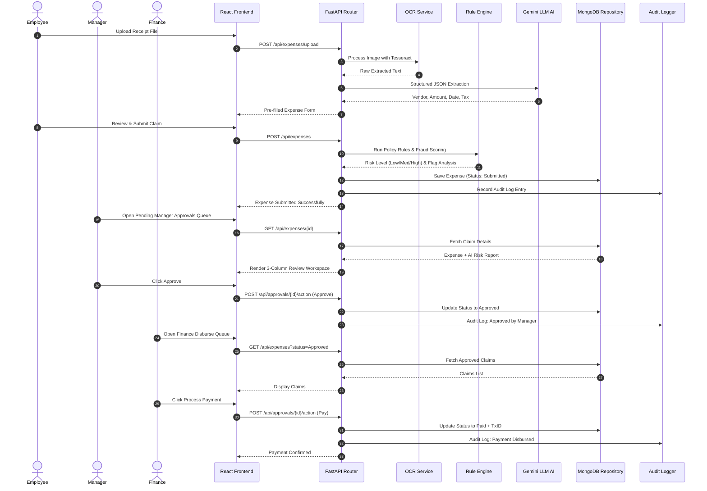

---

## ⚡ 5. Rule-Based Decision Engine Flow

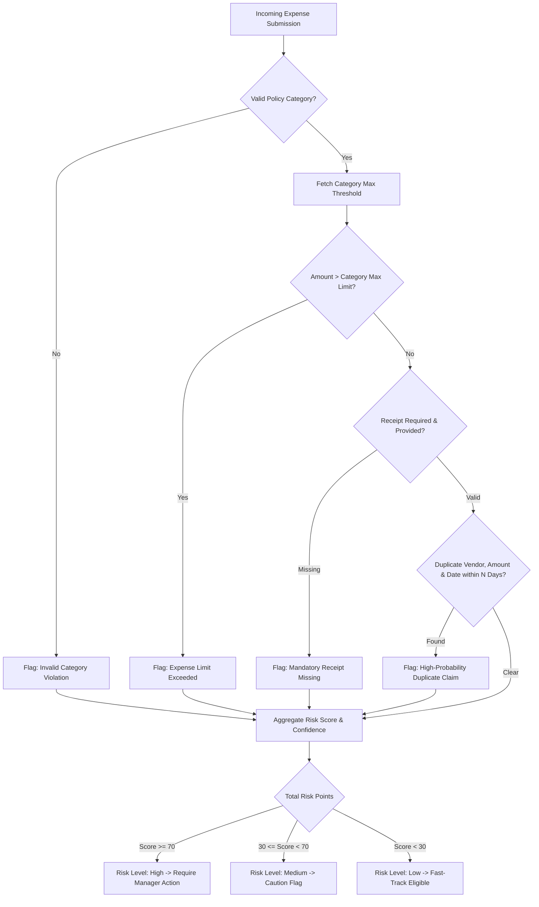

---

## 🤖 6. LangGraph Multi-Agent Workflow

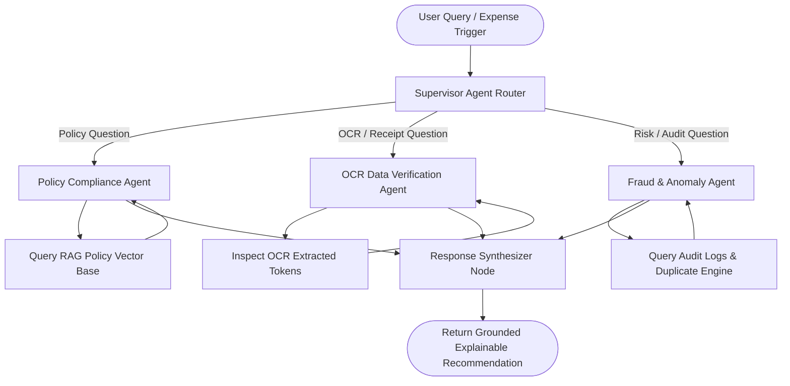

---

## 🧠 7. AI Query Processing & Forced Routing

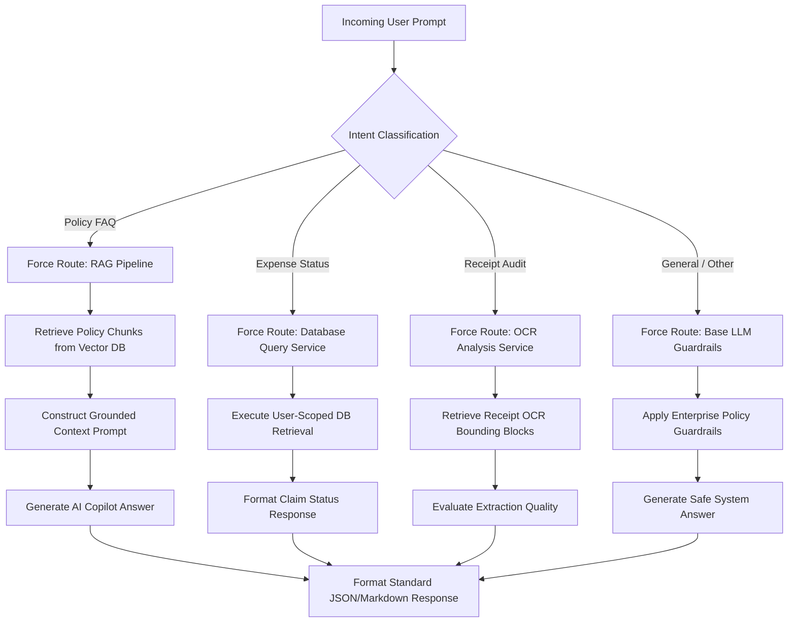

---

## 📚 8. Retrieval-Augmented Generation (RAG) Pipeline

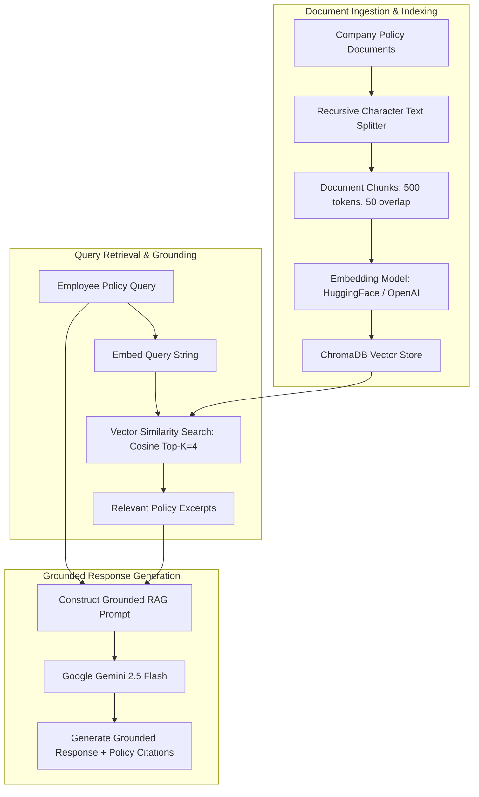
